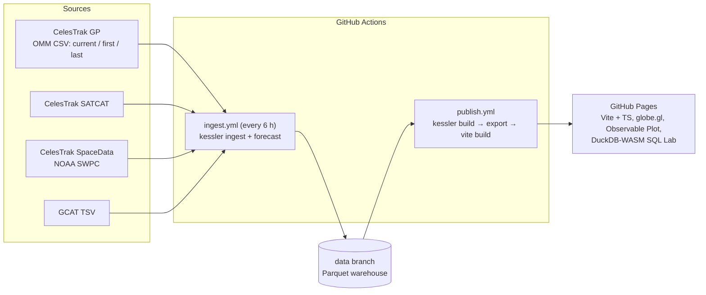

# Kessler: orbital breakup forensics

**Live site: https://devansh-codes.github.io/kessler/**

Kessler reconstructs 2026's satellite and rocket-stage breakups using **only public orbital data**.
For each event it estimates *when and where* the object fragmented, how hard each piece was kicked (Δv),
animates the debris cloud on a 3D globe, forecasts when the pieces will reenter, and ranks launch
vehicles by the debris their upper stages leave behind. An in-browser SQL lab (DuckDB-WASM) exposes
every derived table.

Everything is serverless. Python pipelines on GitHub Actions write a Parquet warehouse on an orphan
`data` branch every six hours. DuckDB computes the analysis, and a Vite/TypeScript site on GitHub Pages
renders the products. No API keys, servers or databases to run.

## What it found

| Event | Public fragments | Kessler result | Versus references |
|---|---|---|---|
| **USA 32** (1988-078, 13 Sep 2026) | 18 (NORAD 101032–101049) | Breakup at argument of latitude 331°, 790 km, 28.8°S 31.6°E. Hybrid t* = 14 Sep 02:15Z, 90% CI 12 Sep 09:37 → 14 Sep 22:15. Fragment Δv median **31 m/s**, p90 51 m/s | The orbit-crossing geometry passes the breakup point **2.7 min** from US Space Forces-Space's 21:13Z and **8 min** from KeepTrack's 05:44Z. The revolution choice is 3 orbits later than S4S. Both references fall between our candidate revolutions |
| **Starlink 34343** (Mar 2026) | 2 (both reentered) | t* 31 Mar, flagged `LOW_CONFIDENCE`: fragments were first catalogued ~90 days after the event | Date-only reference, 29 Mar |
| **Meteor 2-7** (Oct 2026) | 0 new; 24 older pieces | Membership correctly assigns all 24 catalogued pieces to earlier breakups (2004 cloud and later). No 2026 debris is public yet. Parent-only mode | Jim Shell / LeoLabs 09:45Z ±10 min |
| **CZ-6C R/B** (2026-195, NORAD 100472) | 0 | Parent-only. The six-digit NORAD ID round-trips everywhere | LeoLabs 27 Aug 02:30 |
| **Starlink 35956** (Dec 2025) | 0 | Parent-only (parent reentered 17 Jan 2026) | LeoLabs date |
| **Luch / Olymp-K 1** (GEO, stretch) | 1 | Deep-space SDP4 solve, flagged | s2a systems 30 Jan 06:09Z |

**Reentry forecaster** (time-ordered holdout of 554 element sets; 2,611 reentered objects):

| Model | MAE (days) | 80% interval coverage |
|---|---|---|
| Quantile gradient boosting + split-conformal | **2.85** | **83.9%** |
| Same model, raw quantiles | 2.85 | 62.6% |
| Drag-physics baseline | 29.95 | 14.1% |

**Rocket scorecard** (GCAT 1.8.8): Long March 6A has left **55.7 catalogued debris pieces per
launch**. Falcon 9 has left 0.02.

## Architecture



* **Ingest** (`src/kessler/ingest.py`, `http.py`): a polite, cached, sequential client. The first non-200
  response stops every further CelesTrak request in that run, with no retries and a persistent error
  ledger. Cadence state lives on the data branch, so ephemeral runners stay polite too.
* **Warehouse** (`warehouse/`): hive-partitioned Parquet with key-based dedupe. DuckDB views provide
  `gp_latest`, `gp_first` and `satcat_latest`.
* **Forensics** (`forensics/`): membership (time filter + DBSCAN on orbit-plane angle), the hybrid
  epoch solver (SGP4 spread + orbit crossing, bootstrap CI), Δv at each fragment's closest approach to
  the breakup point, and parent-only changepoints.
* **Reentry** (`reentry/`): leakage-guarded time split, 7 quantile HGB models on log-days, CQR
  conformal recalibration, and live forecasts persisted with `issued_at` and scored after decay.
* **Site** (`site/`): hash router with code-split pages. Globe/three.js and DuckDB-WASM load only on
  the routes that need them. Initial JS is about 2 KB gzipped.

## What went wrong (and what we did about it)

1. **TLEs died at NORAD 100000.** The catalog crossed 100,000 on 11 July 2026 and TLEs cannot encode
   six digits. Kessler uses OMM CSV end to end with `int64`/`BIGINT` IDs. A test round-trips NORAD 100472
   through CSV → Parquet → DuckDB → JSON.
2. **Fragments arrive weeks late.** USA 32's debris was first catalogued 24–30 days after the event.
   Back-propagating high-drag fragments (B* up to 1.1) that far with SGP4 leaves the parent–fragment
   spread at thousands of km. The textbook minimum-spread solver landed 140 min early. We added an
   **orbit-crossing** estimator (the parent must lie *on* every fragment orbit at t*), which is immune
   to along-track error. It pins the breakup's position in the orbit to within ~3 km, but not which
   revolution. The hybrid uses both, and the site shows both.
3. **Δv at the wrong instant.** Measuring Δv at t* turns along-track timing error into tens of m/s of
   bogus velocity, and one fragment came out at 18 km/s. Δv is now measured where each fragment's own
   orbit passes closest to the breakup point. Misses over 500 km are flagged unreliable.
4. **Clustering at the wrong epoch.** Propagating high-drag fragments back to the reference time moved
   their planes by 8–15°, so DBSCAN rejected genuine USA 32 debris. Clustering now happens when the
   debris was first catalogued.
5. **Meteor 2-7's 2004 debris shares its designator.** Time filtering plus orbit-plane clustering
   correctly attributes all 24 catalogued pieces to older breakups. No 2026 debris is public yet.
6. **USA 32 "has no public debris".** True on 24 Sep, false by 20 Oct. The plan said parent-only; the
   data said otherwise, so mode selection is automatic.
7. **Day-precision decay labels.** SATCAT decay dates are ±12 h noise. Training labels use noon UTC and
   the methods page says so.
8. **CelesTrak rate limits.** About 50 errors in two hours gets your IP firewalled. We cache for 2 h, stop on the
   first error, keep an error budget of 5, cap the reentry backfill at 40 requests/day, and log every
   request to the Status page.
9. **"Last GP" was undocumented.** The documented endpoints are `gp.php` and `gp-first.php`. The
   decayed-objects page revealed `gp-last.php`, which is what makes a Space-Track-free reentry training
   set possible.
10. **Wrong default branch.** Pushing the orphan `data` branch first made it the repo default, and
    GitHub runs scheduled workflows only from the default branch. `main` is now the default.
11. **A synthetic test that lied.** The first fake-breakup generator converted osculating to mean
    elements twice and put fragments 1,600 km apart at the true breakup time. It now fits SGP4 mean
    elements by fixed-point iteration and adds realistic 5 km along-track noise.

## Run it locally

```bash
uv sync
uv run kessler ingest -w warehouse_repo/warehouse     # polite: cached, stops on first error
uv run kessler forecast -w warehouse_repo/warehouse
uv run kessler build -w warehouse_repo/warehouse
uv run kessler export -w warehouse_repo/warehouse --out site/public/data
cd site && npm ci && npm run dev                       # http://localhost:5173/kessler/
```

To reuse the published warehouse instead of ingesting: `git worktree add warehouse_repo data`.

Tests: `uv run pytest -q` (recorded fixtures, no network) and `cd site && npm test`.

## Data and licenses

Code: MIT. Data is **not** covered by the code license:

* **Orbital data**: [CelesTrak](https://celestrak.org) (Dr. T.S. Kelso), sourced from 18 SDS / Space-Track.
  The site publishes derived products only, not raw element sets (`PUBLISH_RAW_OMM=false`).
* **GCAT**: McDowell, Jonathan C., 2020. *General Catalog of Artificial Space Objects*, Release 1.8.8,
  https://planet4589.org/space/gcat. CC-BY 4.0.
* **Space weather**: CelesTrak SpaceData; NOAA SWPC (public domain).
* **Earth imagery**: NASA Visible Earth Blue Marble (public domain).
* No Space-Track data is used or redistributed.

## Keeping it alive

GitHub disables scheduled workflows after 60 days without repository activity. The ingest job pushes
an empty keepalive commit to `main` if it has been idle for 45 days. The Status page shows the age of
the last ingest. If it ever goes stale, run **Actions → ingest → Run workflow**.
